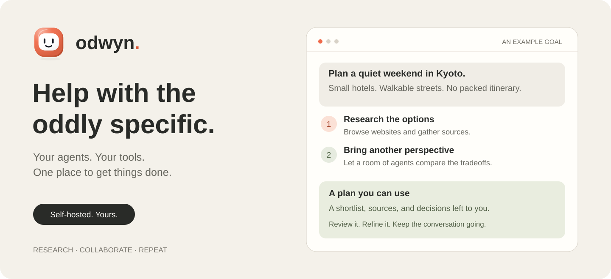
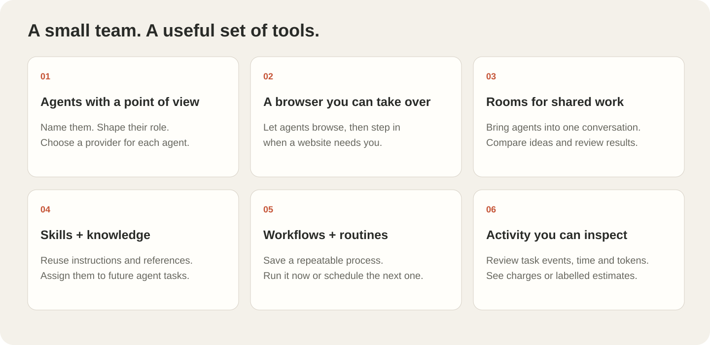
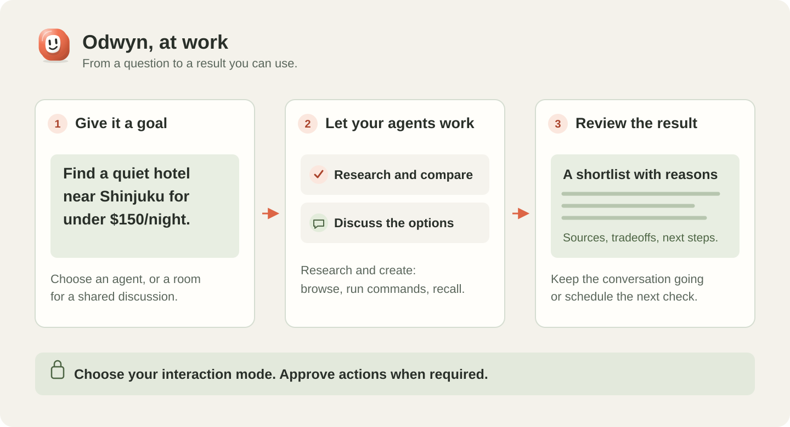

# Odwyn

**Help with the oddly specific.** A self-hosted workspace for AI agents that research, browse, collaborate, and turn your goals into something useful.

[Get started](#get-started) · [Explore the workspace](docs/USAGE.md) · [Connect your AI provider](docs/SETUP.md#connect-a-provider) · [Development](docs/DEVELOPMENT.md)



## Fewer loose ends. More finished plans.

Twelve tabs open. Three options left. Still no decision.

Give Odwyn a goal and a little context. Your agents can research the options, discuss the tradeoffs, and bring back a recommendation, draft, or file. Ask a follow-up, change direction, or save the process for next time.

| Try a goal | Work toward a useful result |
| --- | --- |
| “Find a quiet hotel near Shinjuku within my budget.” | A shortlist with sources and tradeoffs. |
| “Have my agents review this launch plan together.” | A shared recommendation, open questions, and next steps. |
| “Check these sources every Monday.” | A scheduled workflow with saved results to review. |

## Make your own little team

Give each agent a name, a role, a personality, and a provider. Add skills for repeatable work and knowledge for the context they need. Chat with one agent, or bring several into a room for a shared task.



- **Browse together.** Agents use a persistent Chromium session. Take over in a centered browser preview when you need to sign in or handle a page yourself, then hand control back.
- **Keep useful work.** Search skills, knowledge, and workflow history. Reuse instructions, references, and processes across future tasks.
- **See what happened.** The audit log shows task activity, elapsed time, and available token usage. Provider-reported charges and supported API-equivalent estimates are labelled separately.
- **Ask Oddy.** The platform assistant helps manage agents, rooms, workflows, and workspaces in plain language. It asks for approval before making changes.

## From “could you…” to something you can use



Choose the interaction mode for each task. Review results, respond to questions, and approve actions when required. Keep separate workspaces for different projects, with their own agents, chats, files, and browser sessions.

## Bring your AI provider

Run Odwyn on your computer or VPS. Connect **Codex**, **Claude Code**, **Antigravity CLI**, or an **OpenAI-compatible API**. Set a workspace default or choose a different provider for an individual agent.

CLI providers use their connected accounts and available limits; API endpoints follow the provider’s billing. [Provider setup and subscription details →](docs/SETUP.md#connect-a-provider)

## Get started

Install [Bun](https://bun.sh) and your chosen provider’s CLI, or have an OpenAI-compatible API endpoint ready. From the project directory:

```sh
bun install --frozen-lockfile
bun run browser:install
bun run setup
bun start
```

Open **http://127.0.0.1:4317**, sign in with the credentials saved in `.env`, connect your provider, and create your first agent.

Terminal commands run on the host with the server user’s permissions. Use a dedicated ordinary user for deployment. [Full setup, authentication, and VPS guide →](docs/SETUP.md)

## Go a little deeper

| Guide | What’s inside |
| --- | --- |
| [Setup](docs/SETUP.md) | Installation, providers, deployment, and backups. |
| [Using Odwyn](docs/USAGE.md) | Agents, rooms, browser controls, Oddy, and audit logs. |
| [Workflows and skills](docs/WORKFLOWS.md) | Reusable instructions, multi-step work, and scheduled routines. |
| [Development](docs/DEVELOPMENT.md) | Architecture, local development, and verification. |
